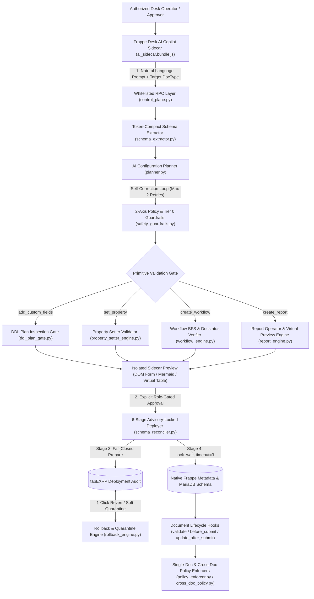
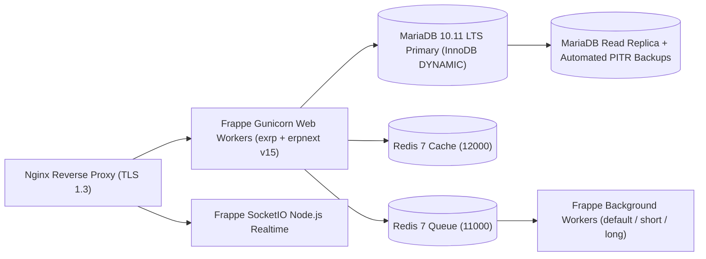

# EXRP Implementation, Frappe Delta Analysis, and Production Deployment Report

- **Repository:** `https://github.com/sayegh9/EXRP.git` (`develop` branch)
- **Target Runtime:** Frappe Framework `v15.126.0` / ERPNext `v15.124.5` + MariaDB `10.6.28 / 10.11 LTS` + Redis `7.2.4-alpine`
- **Architecture Baseline:** [ADR-001 (Rev 2.3)](file:///home/samx/Documents/projects/EXRP/docs/architecture/ADR-001-foundation.md) & [POC-001 Release-Gate Report](file:///home/samx/Documents/projects/EXRP/docs/architecture/POC-001-empirical-evidence.md)
- **Automated Verification Suite:** **94 / 94 tests passing** (unit + live MariaDB lock contention & reconciliation tests)

---

## 1. Executive Overview & End-to-End Architecture

**EXRP** transforms Frappe/ERPNext v15 into an AI-native, self-configuring enterprise platform while preserving 100% of stock ERPNext's transactional and double-entry accounting integrity. Rather than allowing an LLM to generate raw SQL, arbitrary Python, or client scripts, EXRP compiles natural-language operator requests into a strictly typed **Declarative Configuration DSL** across four native Frappe primitives (`Custom Field`, `Property Setter`, `Workflow`, and `Report Builder`).



---

## 2. Everything Implemented So Far (Phases 1–4 + Full ERP Environment)

Across Phases 1 through 4, **19,221 lines** of production Python, JavaScript, CSS, test suites, and architecture documentation have been engineered and verified.

### 2.1 Phase 1 — Guarded Schema Control Plane & Zero-Downtime DDL Foundation
* **Token-Compact Schema Extractor ([`schema_extractor.py`](file:///home/samx/Documents/projects/EXRP/exrp/ai_control_plane/schema_extractor.py), 78 LOC):** Extracts effective DocType metadata while stripping layout noise (`Section Break`, `Column Break`, print/permission matrices), reducing LLM prompt context from ~15,000+ tokens to <1,500 tokens per turn.
* **2-Axis Safety & Tier 0 Invariant Guardrails ([`safety_guardrails.py`](file:///home/samx/Documents/projects/EXRP/exrp/ai_control_plane/safety_guardrails.py), 334 LOC):**
  * Locks **Tier 0 DocTypes** (`GL Entry`, `Stock Ledger Entry`, `Sales Invoice`, `Account`, `Journal Entry`, `Payment Ledger Entry`, `DocType`, `User`, `Role`, `EXRP Settings`) against any AI mutation.
  * Locks **Tier 0 Fields** across parent and child tables (`Sales Order Item.rate`, `bypass_credit_limit_check`, `grand_total`, `debit`, `credit`).
  * Enforces canonical field naming (`^custom_[a-z][a-z0-9_]{1,50}$`) and the 8-type `PHASE_1_ALLOWED_FIELDTYPES` allowlist (`Data`, `Check`, `Int`, `Float`, `Date`, `Datetime`, `Select`, `Link`).
* **Version-Pinned DDL Plan Inspection Gate ([`ddl_plan_gate.py`](file:///home/samx/Documents/projects/EXRP/exrp/ai_control_plane/ddl_plan_gate.py), 602 LOC):**
  * Intercepts and simulates `MariaDBTable` schema synchronization before execution.
  * Blocks Single DocTypes (`issingle = 1`) from physical DDL generation.
  * Approves synchronous execution **only** when the diff emits a single statement matching `APPROVED_DDL_REGEX` (`^ALTER TABLE \`tab[A-Za-z0-9_ ]+\` ADD COLUMN \`custom_[a-z][a-z0-9_]{1,50}\` [A-Za-z0-9_(), ']+$`). Any `MODIFY COLUMN`, `DROP`, or secondary index query is blocked and routed to `QUEUE_FOR_CONTROLLED_ADMIN_DEPLOYMENT`.
* **6-Stage Durable Schema Reconciler ([`schema_reconciler.py`](file:///home/samx/Documents/projects/EXRP/exrp/ai_control_plane/schema_reconciler.py), 313 LOC):**
  * **Stage 1 (Acquire):** Acquires a bounded 56-character MariaDB session-scoped advisory lock (`exrp:v1:<sha256(site\0doctype)[:48]>`).
  * **Stage 2 (Inspect):** Verifies `base_revision_hash`, pre-existing metadata/column state, and the DDL Plan Gate.
  * **Stage 3 (Prepare):** Commits an immutable `PREPARED` audit record and `payload_hash` to `tabEXRP Deployment Audit` (**fail-closed** before DDL).
  * **Stage 4 (Apply):** Sets `SET SESSION lock_wait_timeout = 3` and inserts the native `Custom Field` document.
  * **Stage 5 (Reconcile):** Evaluates the 6-row `ExhaustiveSnapshot` matrix against `tabCustom Field` and `information_schema.columns`.
  * **Stage 6 (Finalize):** Records terminal status (`APPLIED`, `FAILED_CLEAN`, or `RECOVERY_REQUIRED`), clears Frappe cache, and releases `GET_LOCK` in `finally`.
* **Conversational AI Planner ([`planner.py`](file:///home/samx/Documents/projects/EXRP/exrp/ai_control_plane/planner.py), 1,241 LOC) & Settings ([`exrp_settings.json`](file:///home/samx/Documents/projects/EXRP/exrp/exrp/doctype/exrp_settings/exrp_settings.json)):**
  * Integrates with the Google GenAI Interactions API (`client.interactions.create`) with automated self-correction loops when a proposal violates safety or graph rules.
  * Disables 90s internal SDK sleep-backoff (`max_retries = 0`, `HttpRetryOptions(attempts=1)`, 12s timeout) and cascades across `gemini-3.8-flash` -> `gemini-3.5-flash-lite` -> `gemini-3-flash-preview` -> deterministic mock fallback to prevent Gunicorn worker timeouts.
  * Filters Frappe client-side masked password strings (`*` / `•`) via `_is_masked_password()` so `EXRP Settings.get_password("api_key")` is always used.
* **Runtime Policy Enforcer ([`policy_enforcer.py`](file:///home/samx/Documents/projects/EXRP/exrp/ai_control_plane/policy_enforcer.py), 566 LOC):** Enforces `THRESHOLD_GATE`, `FIELD_CONSTRAINT`, `SUBMIT_LOCK`, and `INVARIANT_GUARD` rules on `validate`, `before_submit`, and `before_update_after_submit`.

### 2.2 Phase 2 — Property Setter Engine, In-Place Form Preview & 1-Click Rollback
* **Property Setter Engine ([`property_setter_engine.py`](file:///home/samx/Documents/projects/EXRP/exrp/ai_control_plane/property_setter_engine.py), 382 LOC):** Safely mutates `label`, `description`, `reqd`, `read_only`, `hidden`, `default`, and `options` via native `Property Setter` records after verifying Tier 0 field locks and capturing pre-mutation baselines.
* **1-Click Rollback & Soft-Quarantine Engine ([`rollback_engine.py`](file:///home/samx/Documents/projects/EXRP/exrp/ai_control_plane/rollback_engine.py), 495 LOC):**
  * **Property Setters:** Restores exact baseline values (or deletes newly created `Property Setter` records) -> `ROLLED_BACK`.
  * **Custom Fields:** Applies non-destructive soft quarantine (`hidden = 1, reqd = 0`) preserving all historical column data without risky `DROP COLUMN` locks -> `QUARANTINED`.
  * **Workflows & Reports:** Restores previous active workflow or sets `is_active = 0` / `disabled = 1` -> `ROLLED_BACK`.
* **In-Place DOM Form Preview ([`ai_sidecar.bundle.js`](file:///home/samx/Documents/projects/EXRP/exrp/public/js/ai_sidecar.bundle.js), 2,698 LOC & [`ai_sidecar.css`](file:///home/samx/Documents/projects/EXRP/exrp/public/css/ai_sidecar.css), 2,153 LOC):** Injects interactive `[EXRP PREVIEW - NOT DEPLOYED]` controls directly into `cur_frm` at the target `insert_after` position without dirtying `cur_frm.doc`.

### 2.3 Phase 3 — Declarative Workflow State Machines & Graph Verification
* **Workflow Engine ([`workflow_engine.py`](file:///home/samx/Documents/projects/EXRP/exrp/ai_control_plane/workflow_engine.py), 707 LOC):**
  * Validates multi-stage approval state machines using Breadth-First Search (BFS) reachability from initial `doc_status = 0` states.
  * Detects and rejects orphan states, non-terminal dead-end states, and illegal Frappe `docstatus` transitions (`1 -> 0` Submitted-to-Draft, `2 -> *` transitions out of Cancelled, and `0 -> 2` Draft-to-Cancelled).
  * Automatically generates Mermaid state diagrams (`stateDiagram-v2`) rendered in the Sidecar preview card before deployment.

### 2.4 Phase 4 — Declarative Report Builder & Cross-Document Policy Catalog
* **Report Builder Engine ([`report_engine.py`](file:///home/samx/Documents/projects/EXRP/exrp/ai_control_plane/report_engine.py), 665 LOC):**
  * Compiles natural-language analytics requests into native Frappe `Report` (`report_type = "Report Builder"`) JSON configurations with columns, filters, sorting, and chart definitions (`Bar`, `Line`, `Pie`, `Donut`).
  * Prevents SQL injection via strict operator whitelisting (`ALLOWED_OPERATORS`) and alphanumeric fieldname validation, and blocks system/ledger DocTypes (`PROHIBITED_REPORT_DOCTYPES`).
  * Generates a 5-row **Virtual Data Preview Table** (`[VIRTUAL DATA PREVIEW - 0 DB DDL]`) in the Sidecar before saving any metadata.
* **Cross-Document Referential Policy Catalog ([`cross_doc_policy.py`](file:///home/samx/Documents/projects/EXRP/exrp/ai_control_plane/cross_doc_policy.py), 244 LOC):**
  * Enforces multi-document integrity rules across linked transactions (`XDOC_DN_SO_MUST_BE_SUBMITTED`, `XDOC_SI_SO_CANNOT_BE_CANCELLED`, and `AMOUNT_CANNOT_EXCEED_LINKED`).

### 2.5 Full-ERP Mock Dataset & Frappe Desk Workspaces
* **ERP Provisioning Engine ([`setup_demo_doctypes.py`](file:///home/samx/Documents/projects/EXRP/exrp/setup_demo_doctypes.py), 1,097 LOC):**
  * Idempotently provisions **20 ERP DocTypes**, **9 Governance Roles**, **163 realistic records**, and **6 Frappe Desk Workspaces** (`EXRP Enterprise ERP`, `Selling and CRM`, `Buying and Procurement`, `Inventory and Stock`, `Accounting and Finance`, `HR and Projects`).

---

## 3. Architectural Delta Over Original Frappe / ERPNext Branch

> [!IMPORTANT]
> **Zero Core Modifications:** EXRP makes **zero modifications** to upstream `frappe` (`v15.126.0`) or `erpnext` (`v15.124.5`) source files. All capabilities are packaged strictly inside the standalone `exrp` Frappe custom application (`exrp/`) and wired through standard Frappe extension points in [`exrp/hooks.py`](file:///home/samx/Documents/projects/EXRP/exrp/hooks.py).

| Architectural Layer | Stock Frappe / ERPNext v15 Behavior | What EXRP Adds Over Stock Frappe |
|---|---|---|
| **Configuration UX** | Manual admin forms (`Customize Form`, `Custom Field`, `Property Setter`, `Workflow`, `Report Builder`) requiring schema knowledge. | Conversational **AI Copilot Sidecar** (`ai_sidecar.bundle.js`) docked in Frappe Desk with target DocType selector, quick-prompt chips, and animated deployment progress. |
| **Schema Synchronization (`updatedb`)** | Inserting a `Custom Field` immediately runs `MariaDBTable.sync()`, which can emit unexpected `MODIFY COLUMN` or index rebuilds across the whole table with no dry-run gate. | **Pre-Execution DDL Plan Gate** (`ddl_plan_gate.py`) + **6-Stage Reconciler** (`schema_reconciler.py`) with `GET_LOCK` serialization, `lock_wait_timeout = 3`, and 1-statement `APPROVED_DDL_REGEX` enforcement. |
| **Preview Mechanism** | None — changes take effect immediately in production metadata upon clicking Save. | **Request-Scoped Isolated Previews**: In-Place DOM form injection for fields/properties, Mermaid state graphs for workflows, and 5-row virtual tables for reports. |
| **Accounting & Invariant Protection** | `System Manager` can accidentally alter or hide critical fields or attach broken workflows to core DocTypes. | **2-Axis Policy Gate** (`safety_guardrails.py`) + **BFS State-Machine Verifier** (`workflow_engine.py`) permanently locking Tier 0 DocTypes (`GL Entry`, `Stock Ledger Entry`, `Sales Invoice`) and child pricing fields (`Sales Order Item.rate`). |
| **Audit & Rollback** | Separate `Version` logs; deleting a `Custom Field` leaves orphan columns or requires manual cleanup; no 1-click baseline restore. | **Unified Atomic Audit Journal** (`tabEXRP Deployment Audit`) committed *before* DDL, paired with **1-Click Rollback & Soft Quarantine** (`rollback_engine.py`). |
| **Cross-Document Enforcement** | Relies on controller code or custom `Server Script` Python snippets. | Declarative **Runtime & Cross-Doc Policy Catalogs** (`policy_enforcer.py`, `cross_doc_policy.py`) bound via `doc_events` (`validate`, `before_submit`, `before_update_after_submit`). |

---

## 4. Recommended Production Deployment Strategy

### 4.1 Production Infrastructure Topology
To preserve the empirical guarantees verified in [POC-001](file:///home/samx/Documents/projects/EXRP/docs/architecture/POC-001-empirical-evidence.md), deploy EXRP using the following production topology:



### 4.2 Database & Worker Configuration Requirements
1. **MariaDB 10.11 LTS Configuration (`my.cnf`):**
   * `innodb_default_row_format = DYNAMIC` (required for `ALGORITHM=INSTANT` nullable trailing column additions).
   * `innodb_buffer_pool_size` set to 60–70% of dedicated DB host RAM.
   * Enable binary logging (`log_bin = ON`, `binlog_format = ROW`) for Point-in-Time Recovery (PITR).
2. **Gunicorn Web Worker Configuration:**
   * Run with `--timeout 120 --workers <2 * CPU + 1> --preload`.
   * Because EXRP bounds MariaDB metadata lock waits to `3.0s` (`SET SESSION lock_wait_timeout = 3`) and LLM HTTP calls to `12.0s` (`HttpRetryOptions(attempts=1)`), synchronous EXRP calls never risk exhausting Gunicorn worker pools.
3. **Zero-Downtime App Installation & Upgrade Runbook:**
   ```bash
   # 1. Fetch and install EXRP into the Frappe v15 bench
   bench get-app https://github.com/sayegh9/EXRP.git --branch develop
   bench --site <production-site> install-app exrp

   # 2. Run migrations during a scheduled low-traffic window and build assets
   bench --site <production-site> migrate
   bench build --app exrp
   bench --site <production-site> clear-cache

   # 3. Gracefully reload Gunicorn workers without dropping active connections
   kill -HUP <gunicorn-master-pid>
   ```
4. **Handling `QUEUE_FOR_CONTROLLED_ADMIN_DEPLOYMENT` Items:**
   * Single additive fields (`ONLINE_ADDITIVE_DDL`) and metadata-only changes (`Property Setter`, `Workflow`, `Report Builder`) deploy synchronously in <1 second via the Sidecar.
   * Any proposal flagged as `QUEUE_FOR_CONTROLLED_ADMIN_DEPLOYMENT` (multi-field batches, index additions, or tables with pre-existing drift) is logged in `tabEXRP Deployment Audit` and should be executed by a `System Manager` during a scheduled maintenance window via `bench --site <production-site> migrate`.

### 4.3 Security & LLM Operational Hardening
* **API Key Storage:** Store the production Gemini/OpenAI API key in `EXRP Settings` (which encrypts it in `__Auth` using the site's `encryption_key` in `site_config.json`) or inject `GEMINI_API_KEY` via a secret manager (Vault / AWS Secrets Manager / Kubernetes Secret).
* **Paid Tier / Vertex AI Endpoint:** For production multi-user environments, use a Billing-Enabled Gemini API key (`gemini-3.5-flash-lite` or `gemini-3.8-flash`) so operators do not hit the 20 req/day Free Tier quota.
* **Role Segregation:** Assign `Finance Director` and `Operations Director` roles strictly to designated human approvers; give general staff `Sales User` so they can propose and preview changes in the Sidecar without direct production deployment privileges.

---

## 5. Prioritized Recommendations for Next Steps (Phase 5 Roadmap)

With Phases 1–4 complete and verified, the following four initiatives provide the highest operational leverage for **Phase 5**:

| Priority | Initiative | Scope & Deliverable | Business / Technical Value |
|:---:|---|---|---|
| **P1** | **Phase 5A: Controlled Maintenance-Window Queue Runner & Admin Dashboard** | Build an interactive **EXRP Deployment Queue & Audit Workspace** (`EXRP Deployment Audit` Frappe DocType view + scheduled background runner) so `System Manager`s can review, schedule, and batch-execute `QUEUE_FOR_CONTROLLED_ADMIN_DEPLOYMENT` items (multi-field bundles and index additions) during off-peak windows. | Completes the lifecycle for complex multi-field requests that are currently held by the synchronous single-field gate. |
| **P2** | **Phase 5B: Conversational Runtime & Cross-Doc Policy Authoring** | Extend `AIConfigurationPlanner` (`planner.py`) with a 5th intent (`create_policy`) allowing directors to create and persist custom `RuntimePolicy` and `CrossDocPolicy` rules conversationally (e.g., *"Block submitting any Purchase Order over \$100,000 unless supplier is not on hold"*) with 1-click rollback. | Connects the existing `policy_enforcer.py` and `cross_doc_policy.py` engines directly to the natural-language Copilot Sidecar. |
| **P3** | **Phase 5C: Automated CI/CD Pipeline & Playwright E2E Browser Suite** | Add `.github/workflows/exrp-ci.yml` running the 94 unit/MariaDB tests on every PR, plus a headless Playwright suite exercising the Desk Sidecar UI (`Propose -> In-Place Preview -> Deploy -> 1-Click Revert`). | Locks in regression protection across both backend Python engines and the vanilla JS Sidecar bundle. |
| **P4** | **Phase 5D: Quarantine Decommissioning CLI (`bench exrp-prune-quarantine`)** | Implement an administrative CLI command that scans `QUARANTINED` custom fields, verifies zero non-null historical rows (or exports a CSV archive), and safely drops retired columns during maintenance windows. | Prevents long-term MariaDB column accumulation from soft-quarantined fields. |
